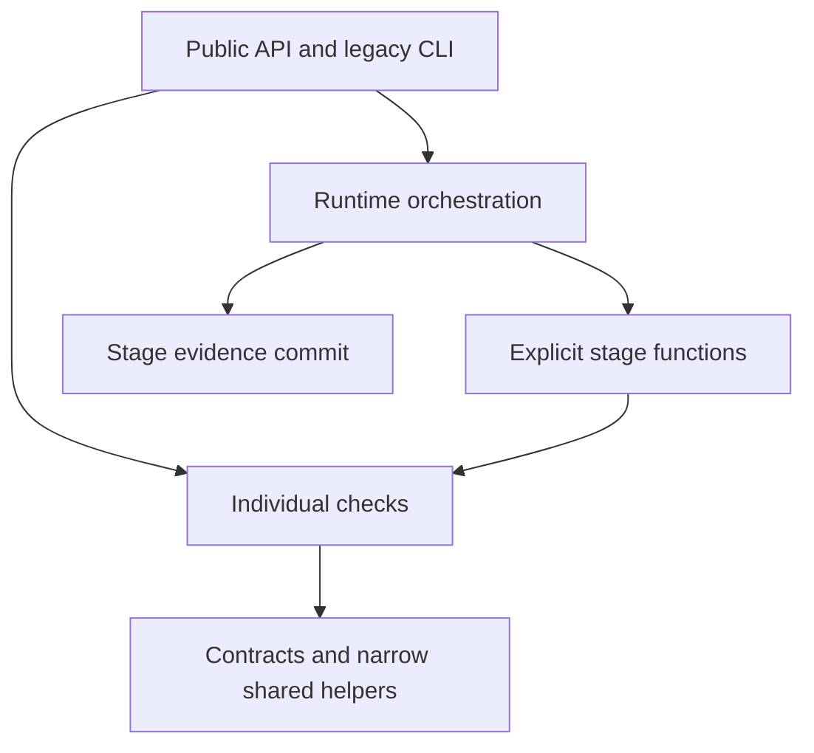

# Guard rc.8: functional boundaries

The design goal is to make a rule's implementation, contract and evidence easy to find and change together. File length is a review signal, not a score. A module should own one coherent responsibility; a cross-cutting scenario can stay together when its shared setup explains the behavior being checked.

## Supported entry and dependency direction

`scripts/awf_guard/api.py` exports the supported names declared in `public-contract.json`. The original import/CLI facade remains available. New callers should avoid private names exported historically by that facade. Relocating a private implementation does not require updating acceptance tests; public behavior and contract changes do.

The supported API intentionally exposes both whole-station execution and individual checks. `api.py` and the compatibility facade contain exports, not duplicate implementations. `module-map.json` records the current ownership and imports for navigation; it is not an architectural score or acceptance constraint.

## Ownership decisions

| Responsibility | Owner | Why this boundary exists |
|---|---|---|
| Exceptions, numeric extraction, AST utilities | `errors`, `numeric_inputs`, `ast_utils` | Separate failure vocabulary, numerical adapters and source-analysis helpers; no catch-all `core` |
| Tensor units/domains, symbolic shapes, station configuration | `tensor_contracts`, `shape_contracts`, `station_spec` | Independent contracts with different reasons to change |
| Derivatives, convergence and mesh/noise comparisons | `differential_checks` | Compare an operator across perturbation or resolution changes |
| SE3/PBC/permutation, scaling, pair exchange | `symmetry_checks` | Input transformations and their expected output laws |
| LOOCV, weighted dispersion and variance | `statistical_checks` | Statistical estimators and generalization properties |
| Matrix metrics, pencil gauge and coupled basis/locality | `matrix_checks` | Matrix/operator representation and invariants |
| SVD update trajectory | `optimization_checks` | Optimization history, separate from source-code audit |
| Topology, heterogeneous radii and director geometry | `geometry` | Geometry-specific inputs and probes |
| Runtime sequencing | `runtime` + four stage modules | Explicit function calls replace multiple inheritance |
| Evidence commit | `execution_flow` | One place checks labels, ownership of receipt fields and commit-on-success |
| Positive geometry/statistics/matrix scenarios | Corresponding `awf_guard_selftests` modules | Test ownership follows the behavior it verifies |
| Correct reference geometry | `awf_guard_selftests/geometry_fixtures` | Positive tests no longer depend on the negative-control runner |

Shared contracts may have many importers. That is not itself a defect: a contract is useful precisely because several checks agree on it. Move a definition when it has a different responsibility, not to lower an import count or hit a file-count target.

The coupled-operator/declarative integration scenario deliberately remains together: two interfaces exercise one fixture. Other historical integration packs remain compatibility coordinators or end-to-end scenarios; this release does not claim every historical grouping is ideal. Further extraction should be driven by a specific independent change or confusing dependency.

## Evidence and invariants

- Length is advisory by default. Self-audit reports functions above 200 lines and files above 1000 lines for human review. Explicit limits remain enforceable contracts. Every nested source file is scanned regardless of length; W1/W2 remain absent.
- Runtime stages receive fresh evidence dictionaries. Unknown labels, malformed labels, destination shape errors, overwrites and exceptions fail before committing stage evidence. This does not roll back external operator side effects or diagnostic callbacks, and it is not thread-safety isolation.
- Complete acceptance uses the pinned 14-slot/74-subcheck receipt contract, known-wrong implementations, force-PASS mutants and nonfinite injections. Supported exports must agree with the legacy facade. File counts and private definition locations are not pass/fail criteria.
- The historical rc.6 migration AST check covered its stage-method conversion. rc.7 deliberately changes evidence and test-analysis rules; acceptance now includes the newly discovered counterexamples and complete station replay. Historical migration hashes are not used to certify these new behaviors.

## Maintenance limits

The old private exports and four stage adapter classes remain transitional compatibility surface. The runtime has no mixin inheritance. Receipt payloads remain dictionaries rather than a new object hierarchy; their validation is centralized at stage boundaries. AST heuristics can still flag a legitimate simplification, and finite adversarial tests do not prove correctness for all operators. Retain counterexamples when improving a rule, and review whether its measured proxy still matches its purpose.

## Evidence boundary additions

`evidence_contracts` owns nonempty cases, callable origins and upstream receipt schemas. `test_reachability` owns bounded lexical assertion analysis. `fixture_policy` owns byte-pinned numeric allowances. These are functional responsibilities; the advisory length policy remains unchanged. Independent verifier 1.0.0-rc.2 checks execution evidence as well as canonical labels.

## rc.8 closure hardening

`evidence_contracts` enforces runtime `sys.setprofile` non-reentry (`call_without_target_reentry`) in addition to static callable-origin distinctness. `information` isolates holdout secrets in a module-private `WeakKeyDictionary` vault and checks nested forbidden keys recursively. `tensor_contracts` enforces `QuantityTensor` unit tags on dimensional specs by default. `execution_flow` stages `borderline_warnings` alongside `gates_passed` so aborted stages leave zero state residue. Independent verifier `1.0.0-rc.3` validates non-vacuous execution evidence across all 14 canonical slots and runs engine checks in isolated `-B` subprocesses.
